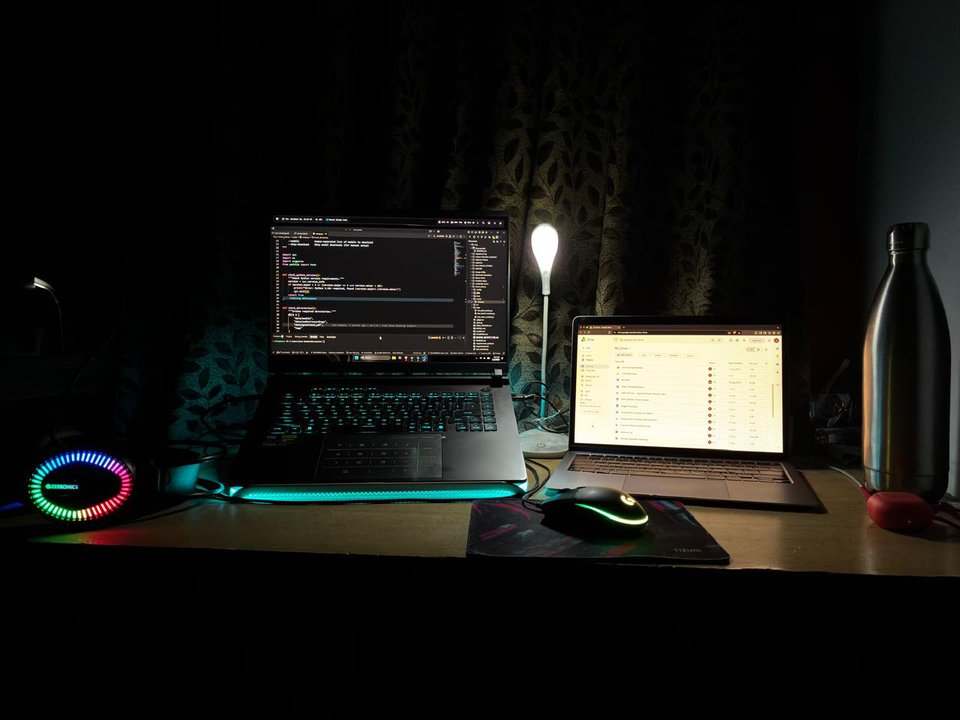

# Hey there, I'm Aumnamaha Thirunagari 👋
### Agentic AI Systems Engineer & Local LLM Optimization Specialist
**B.Tech CSE (AI & ML) Candidate @ GITAM School of Technology • Hyderabad, India**

<table width="100%" border="0">
  <tr>
    <td width="55%" valign="top">
      
      
        
      <ul>
        <li>🔬 <b>Building:</b> Zero-Trust FL pipelines (FedTrustChain) & CUDA NVMe acceleration engines.</li>
        <li>⚡ <b>Specializing:</b> Low-level C++/CUDA kernels, hybrid cloud-local routing, and AST parsers.</li>
        <li>💻 <b>Workstation:</b> Windows 11 (RTX 5070 Ti, Intel Core Ultra 9) & Apple MacBook Air.</li>
        <li>📧 <b>Reach me:</b> <a href="mailto:aumnamaha@example.com">aumnamaha@example.com</a></li>
        <li>🌐 <b>Portfolio:</b> <a href="https://portfolio-repo-brown.vercel.app">portfolio-repo-brown.vercel.app</a></li>
        <li>⚡ <b>Fun fact:</b> AI Hardware & Local LLM Runtime Enthusiast</li>
      </ul>
    </td>
    <td width="45%" align="center" valign="middle">
      
    </td>
  </tr>
</table>

### 🤝 Connect with me:

  
  
  
  

---

### 🚀 Tech Stack

  
  
  
  
  
  
  
  
  

---

### 📊 GitHub Analytics & Activity Dashboard

  
  

  

  

---

### About Me 🔭

**Aum Namaha** — Final-year **B.Tech CSE (AI & ML)** candidate at **[GITAM School of Technology](https://gitam.edu)**, Hyderabad. Passionate about building production-grade AI systems, federated learning pipelines, and low-latency edge computing frameworks.

> ⚡ Specializing in **CUDA kernel development**, hybrid cloud-local ML routing, and trust-aware federated systems

---

### 💻 Systems & Hardware Matrix

| Platform | Specs |
|---|---|
| 🪟 Windows 11 (Primary) | RTX 5070 Ti · Intel Core Ultra 9 · 32 GB RAM · CUDA 13.x |
| 🍎 macOS (Secondary) | MacBook Air · Apple Silicon · Metal / MPS acceleration |

---

### 🛠️ Technical Mastery Matrix

| Domain | Stack |
|---|---|
| **Deep Learning** | PyTorch (`cu121`/`cu132`) · Scikit-learn · XGBoost · FAISS · ChromaDB · Sentence-Transformers |
| **Low-Level / Acceleration** | C++20/C23 · MSVC/GCC/nvcc · CUDA kernels · CMake · PyNVML telemetry |
| **Web & API Backend** | FastAPI · Flask · Streamlit · Uvicorn · Waitress · ASGI/WSGI |
| **MLOps & Testing** | Pytest (with coverage) · Ruff + Black linting · WandB tracking · Docker containerization |
| **Verification** | AST analysis · Structural model validation · Deterministic hash-based integrity checks |

---

### ⚡ Key Repositories

<table width="100%">
  <thead>
    <tr>
      <th align="left" width="28%">Project</th>
      <th align="left" width="48%">Description</th>
      <th align="left" width="24%">Tech Stack & Status</th>
    </tr>
  </thead>
  <tbody>
    <tr>
      <td><b><a href="https://github.com/Aumnamaha/A11-LLM-optimizer">⚡ A11-LLM-optimizer</a></b></td>
      <td>Low-level LLM inference acceleration engine with NVMe <code>mmap</code> tensor streaming & C++/CUDA kernels.</td>
      <td> </td>
    </tr>
    <tr>
      <td><b><a href="https://github.com/Aumnamaha/SentryMind">🧠 SentryMind</a></b></td>
      <td>Autonomous incident response agent with persistent long-term vector memory state graphs.</td>
      <td> </td>
    </tr>
    <tr>
      <td><b><a href="https://github.com/Aumnamaha/Student_Feedback_portal">🏛️ Student_Feedback_portal</a></b></td>
      <td>Spec-driven feedback collection portal featuring 4-role RBAC, embedded UML specs, and 100% test coverage.</td>
      <td> </td>
    </tr>
    <tr>
      <td><b><a href="https://github.com/Aumnamaha/FedTrustChain">🛡️ FedTrustChain</a></b></td>
      <td>Zero-trust federated learning framework with dynamic node trust scoring & permissioned blockchain audit log.</td>
      <td> </td>
    </tr>
  </tbody>
</table>

---

### 🎯 Active Focus Areas

- **GATE CS & GATE DA** preparation — Algorithms, OS, Data Structures, Linear Algebra
- **CUDA kernel development** for ML acceleration on RTX 5070 Ti
- **Federated learning systems** with trust-aware aggregation and tamper-proof audit trails
- **Hybrid cloud-local model routing** for cost-efficient inference at scale

---

### 📬 Connect

---

> _"Building systems that learn, adapt, and earn trust — one gradient at a time."_ 🚀
